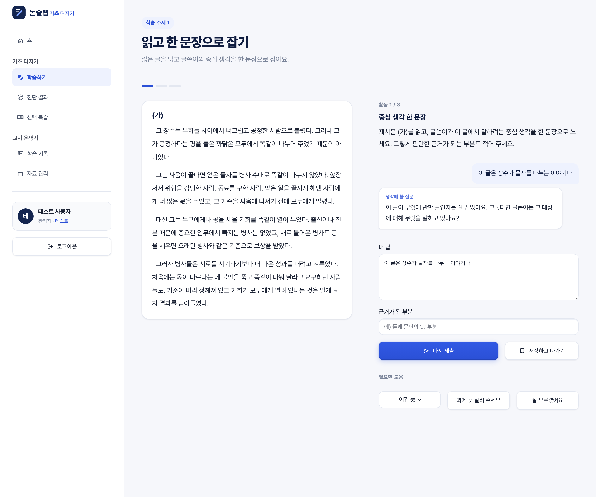
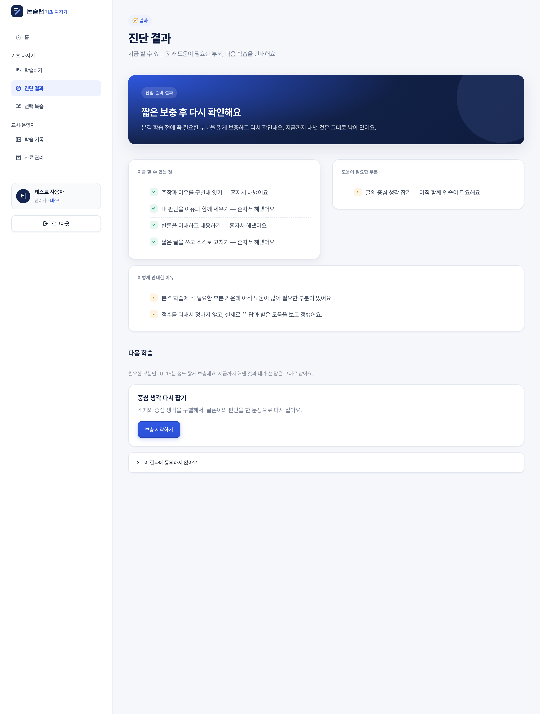
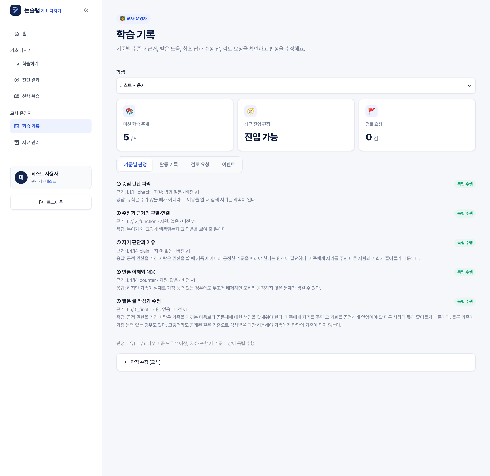

# 📝 엘렝코스 · 논술랩

소크라틱 문답(엘렝코스)으로 논술을 배우는 웹 서비스입니다. 운영 주소: **https://elenchos.kr**

두 가지 과정이 들어 있습니다.

| 과정 | 설명 | 문서 |
|---|---|---|
| **6단계 논술 학습 (MVP)** | 한 문제를 0 준비 → 1~5 문답 → 6 원고지 독립 작성 → 6-1 평가·첨삭 → 돌아보기로 깊이 있게 학습 | [docs/mvp_6stage.md](docs/mvp_6stage.md) |
| 논술 기초 다지기 | 다섯 학습 주제와 진입 준비 판정 (아래 설명) | [docs/INTRODUCTION.md](docs/INTRODUCTION.md), [docs/requirements_traceability.md](docs/requirements_traceability.md) |

| 영역 | 기술 |
|---|---|
| 웹 | FastAPI + Jinja2 + htmx, Vercel Python 함수 (서울 icn1), 도메인 elenchos.kr |
| 저장 | Supabase `elenchos` 스키마. 테이블은 노출하지 않고 서버 비밀키를 확인하는 RPC 함수로만 접근 |
| AI | Claude / OpenAI — 키가 없으면 규칙 기반 데모 역할로 동작. 진행·채점 계산·사다리 규칙은 코드가 소유 |
| 콘텐츠 | `content/mvp/` (단계 카드·문제 패키지·채점표·안내 문안), `content/v1/` (기초 다지기) |

```bash
pip install -r requirements-dev.txt
```

```bash
uvicorn web.main:app --reload --port 8501
```

테스트 계정: `test` / `testpoc` (운영 환경 변수 `APP_ENV=production` 이면 꺼짐)

---

# 논술 기초 다지기

「논술학습 기초다지기 요구사항 정의서」에 따라 만든 **본격 논술 학습 진입 준비 과정**입니다.
학생은 다섯 학습 주제를 한 번씩 수행하고, 필요할 때만 짧은 집중 보충을 받은 뒤 **진입 준비 판정**을 받습니다.

## 🧭 학습 흐름

```
학습 주제 1~5 (각 1회)                     필요할 때만               판정
① 읽고 한 문장으로 잡기       ─┐
② 주장과 이유 연결하기         │
③ 두 글 비교와 추론 점검(1·2차) ├─▶ 진입 준비 판정 ─▶ 집중 보충(S1~S5, 경로당 1회) ─▶ 재확인 ─▶ 재판정
④ 내 주장을 세우고 시험하기    │      (기준 ①~⑤)                                     │
⑤ 짧게 쓰고 고치기(400자)     ─┘                                                     └▶ 본격 6단계 (준비 중)
```

학생은 튜터와 **문답 창**에서 주고받습니다. 과제와 무관한 말·정답 요구·질문은 먼저 구분해 즉시 과제로 되돌립니다.

한 활동 안의 교수 순서 (Z-014): **스스로 시도 → 진단 → 방향 질문(같은 판단점 최대 2회) → 설명 → 별도 사례 시범 → 기록 후 이동**.
지원을 받은 수행은 독립 수행으로 기록하지 않습니다.

| 수준 | 뜻 |
|---|---|
| 3 독립 수행 | 지원 없이 수행 |
| 2 최소 지원 후 수행 | 정답 없는 방향 질문·과제 안내 뒤 수행 |
| 1 집중 지원 후 수행 | 설명·시범 뒤 수행 |
| 0 미형성 | 설명·시범 후에도 수행 미확인 |
| 미확인 | 증거 부족. 오답이 아님 |

진입 판정 (Z-028): 다섯 기준 모두 2 이상 + ①·② 포함 셋 이상이 3 → **진입 가능** / 모두 2 이상이거나 ③~⑤ 중 하나만 1 → **조건부 진입** / ①·② 중 1 이하·0 존재·③~⑤ 중 둘 이상 1 → **집중 보충 후 재확인** / 미확인 → **판정 보류**.

## 📁 폴더 구조

```
.
├── app.py                        # 진입점: 테마 + 역할별 메뉴
├── views/
│   ├── login.py                  # 로그인 / 회원가입
│   ├── home.py                   # 학생 홈: 오늘의 목표, 다섯 학습 주제 진행
│   ├── lesson.py                 # 수업 화면 (제시문 · 과제 · 튜터 대화 · 도움 요청)
│   ├── result.py                 # 진입 준비 결과 · 보충 안내 · 이의 신청
│   ├── review.py                 # 선택 복습 (1-1 ~ 5-7)
│   ├── records.py                # 교사: 기준별 판정·근거·지원 이력·검토 요청·판정 수정
│   └── content_admin.py          # 교사: 자료 버전·내부 출처·사용 중지
├── content/
│   ├── active.yaml               # 새 학습에 쓰는 활성 버전
│   └── v1/
│       ├── excerpts.yaml         # 제시문 (학생에겐 (가) 라벨과 본문만, 출처는 내부)
│       ├── review_items.yaml     # 복습 항목 38개
│       └── bundles/              # L1~L5 학습 주제, S1~S5 보충 경로 23개
├── src/
│   ├── learning/                 # ★ 공통 실행 틀
│   │   ├── content.py            # 콘텐츠 스키마·로더·검증, 글자 수 규칙
│   │   ├── engine.py             # 교수 정책 엔진
│   │   ├── entry.py              # 진입 준비 판정표
│   │   ├── levels.py             # 수준·지원 공통 기록 스키마
│   │   ├── analyzer.py           # AI 분석기 / 데모 분석기
│   │   └── state.py              # 학습 기록 모델
│   ├── ai/                       # Claude·OpenAI 제공자
│   ├── db/                       # Supabase 클라이언트, 학습 기록 저장소(데모/Supabase)
│   ├── services/                 # 인증, 학습 서비스
│   ├── core/config.py            # 환경 설정
│   └── ui/                       # 디자인 토큰·CSS, 공통 컴포넌트
├── supabase/migrations/          # 0001 인증·프로필, 0002 학습 기록
├── tests/                        # 판정표·엔진 정책·로그인 테스트
├── static/fonts/                 # Pretendard (SIL OFL)
└── docs/                         # 요구사항 반영 현황, 실행 화면
```

## 🧪 테스트 로그인 (키 없이 바로 체험)

| 아이디 | 비밀번호 |
|---|---|
| `test` | `testpoc` |

- Supabase·AI 키 없이 학생 화면과 교사 화면을 모두 볼 수 있습니다 (`admin` 권한).
- 기록은 브라우저 세션에만 저장되고, 로그아웃하거나 새로고침하면 초기화됩니다.
- AI 키가 없으면 **데모 분석기**가 콘텐츠에 적힌 키워드 단서로 판정합니다. 시연용이라 타당한 다른 표현을 놓칠 수 있습니다. 키를 넣으면 실제 AI가 같은 판단 기준으로 분석합니다.
- `APP_ENV=production` 또는 `ENABLE_TEST_LOGIN=false`이면 자동 비활성화됩니다.

| 수업 (방향 질문) | 진단 결과 | 교사 학습 기록 |
|---|---|---|
|  |  |  |

> ⚠️ `content/v1`의 제시문은 모두 **시범용 신규 설계문**입니다. 실제 저작의 인용이 아니며, 운영 전에 승인된 발췌문으로 교체해야 합니다.

## 🎨 디자인 시스템

모든 스타일 값은 `public/app.css`의 `:root` 변수에 모여 있습니다.

| 역할 | 값 | 용도 |
|---|---|---|
| Navy 900 / 800 | `#0F1C3F` / `#14254F` | 제목, 히어로·브랜드 패널 |
| Primary | `#2B50D6` | 주요 버튼, 선택 상태, 진행바 |
| Primary 50 | `#EEF2FE` | 선택된 메뉴·탭 배경, 포커스 링 |
| Background | `#F6F7FB` | 앱 배경 (저채도 쿨그레이, 장시간 작업용) |
| Surface | `#FFFFFF` | 카드, 입력창 |
| Text / Muted | `#1B2233` / `#7A8499` | 본문 / 보조 텍스트 |
| Success · Warning · Danger | `#0F9D74` · `#C98112` · `#D64545` | 완료·잠시 멈춤·분량 초과 |

- **글꼴:** Pretendard Variable (자체 호스팅). 제시문은 줄간격 1.95로 장문 가독성 강화
- **모양:** 입력·버튼 10px, 카드 18px 둥근 모서리, 3단계 그림자(`shadow-sm/shadow/shadow-lg`)
- **반응형:** 본문 최대 1120px · 900px/640px 구간에서 여백·글자 크기 축소, 통계 카드 2열, 컬럼 세로 쌓기

## 🚀 시작하기 / 배포

```bash
cp .env.example .env            # 키 입력 (없으면 메모리 저장소 + 데모 AI 로 동작)
```

- 로컬: `uvicorn web.main:app --reload --port 8501`
- 저장소: Supabase SQL Editor 에서 `supabase/migrations/0003_elenchos_store.sql`, `0004_elenchos_feedback.sql` 실행 후 `elenchos.config` 에 `api_key` 등록. Vercel 환경 변수 `SUPABASE_URL`, `SUPABASE_ANON_KEY`, `ELENCHOS_DB_KEY`, `SESSION_SECRET` 설정
- 배포: Vercel 프로젝트 `elenchos` (진입점 `web.main:app`, `vercel.json` 지역 icn1), 도메인 elenchos.kr

## 🧪 LLM 품질 관리 (Ragas)

답변 분석 AI를 정답 라벨 42건(골든셋)과 Ragas(`Faithfulness`, `DiscreteMetric` judge)로 평가하고, 기준 미달이면 실패 처리합니다. 결과는 교사 화면 **AI 품질**에서 확인합니다.

```bash
pip install -r requirements-eval.txt
python -m evals.run_eval --analyzer llm --ragas   # 실제 AI + Ragas (키 필요)
python -m evals.run_eval --analyzer demo          # 키 없이 회귀 기준선
```

자세한 내용: [docs/llm_quality.md](docs/llm_quality.md)

## 🗂 콘텐츠 수정

제시문·판단 기준·첫 대응 질문·설명·시범은 `content/v1/` YAML에서 고칩니다. 앱은 시작할 때 참조 무결성을 검사합니다(없는 제시문·복습 항목, 독립 확인에 시범 자료 사용 등). 진행 중인 학습을 보존하려면 내용을 크게 바꿀 때 `content/v2/`를 새로 만들고 `content/active.yaml`의 버전을 바꾸세요.

## ✅ 테스트 / 린트

```bash
pytest
ruff check .
```

## 🔐 보안 메모
- `.env` 는 `.gitignore`에 포함되어 커밋되지 않습니다. 비밀값은 Vercel 환경 변수에만 둡니다.
- `elenchos` 스키마 테이블은 API 로 노출하지 않고, 서버 비밀키(`ELENCHOS_DB_KEY`)를 확인하는 함수로만 읽고 씁니다. 판정·채점 쓰기는 서버에서만 일어나 학생이 기록을 고칠 수 없습니다.
- 익명 의견은 학습 기록과 다른 테이블에 계정·회차 id 없이 날짜만 남깁니다.
