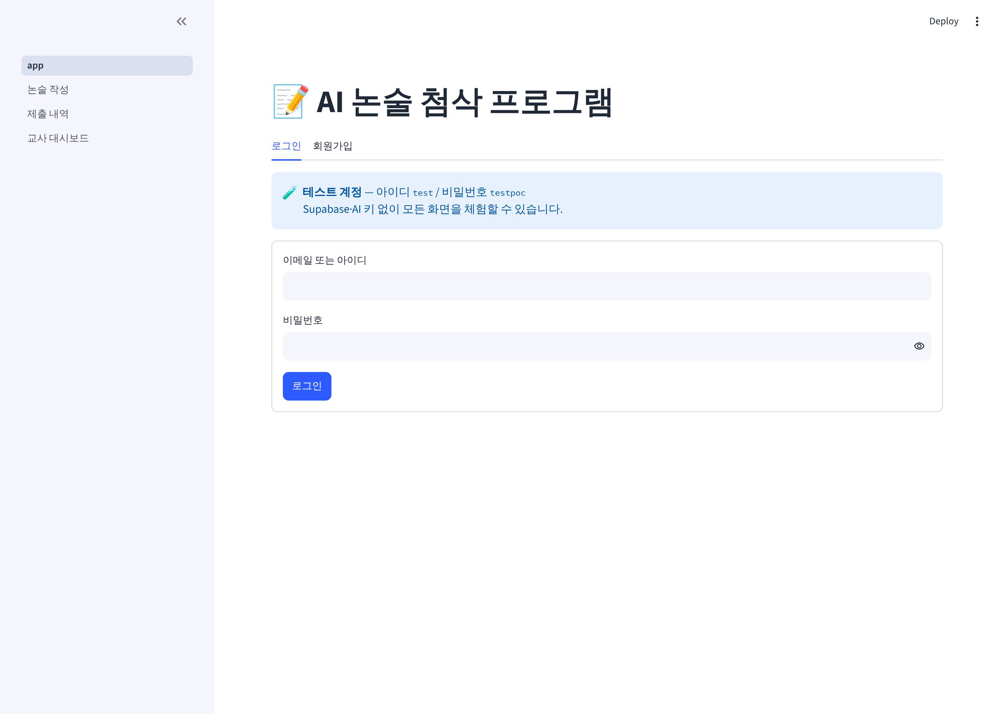
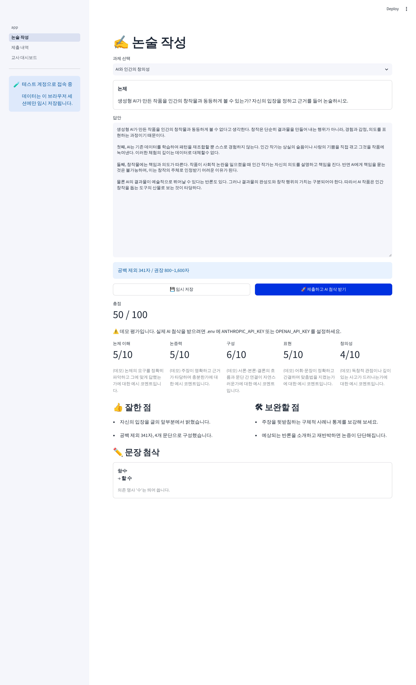

# 📝 AI 논술 첨삭 프로그램

학생이 논술문을 **작성·제출**하면 AI(Claude / OpenAI)가 **루브릭 기반 채점과 문장 첨삭**을 해 주는 웹 프로그램입니다.

| 영역 | 기술 |
|---|---|
| UI | Streamlit (멀티페이지) |
| DB / 인증 | Supabase (PostgreSQL + Auth + RLS) |
| AI | Anthropic Claude API / OpenAI API (`.env`에서 전환) |

## 📁 폴더 구조

```
.
├── app.py                      # 진입점: 홈 / 로그인 / 회원가입
├── pages/                      # Streamlit 멀티페이지 (파일명 순서 = 메뉴 순서)
│   ├── 1_논술_작성.py          # 학생: 과제 선택 → 작성 → 제출 → AI 첨삭
│   ├── 2_제출_내역.py          # 학생: 지난 제출물·피드백 조회
│   └── 3_교사_대시보드.py      # 교사: 과제 출제, 전체 제출물 확인
├── src/
│   ├── core/
│   │   ├── config.py           # 환경설정 (.env / st.secrets → Settings)
│   │   └── models.py           # 도메인 모델 + AI 피드백 스키마(Pydantic)
│   ├── db/
│   │   ├── client.py           # Supabase 클라이언트 싱글턴
│   │   ├── repositories.py     # 테이블별 CRUD (Assignment/Essay/Feedback)
│   │   ├── demo_store.py       # 테스트 로그인용 인메모리 저장소
│   │   └── factory.py          # 로그인 사용자에 맞는 저장소 선택
│   ├── ai/
│   │   ├── base.py             # AIProvider 인터페이스 + JSON 파싱/검증
│   │   ├── claude_provider.py  # Claude 구현
│   │   ├── openai_provider.py  # OpenAI 구현
│   │   ├── mock_provider.py    # 키 없을 때 쓰는 데모 평가기
│   │   ├── factory.py          # AI_PROVIDER 값으로 구현체 선택
│   │   └── prompts.py          # 루브릭·시스템 프롬프트 (평가 기준은 여기서만 수정)
│   ├── services/
│   │   ├── auth_service.py     # 로그인/가입/권한 체크
│   │   └── feedback_service.py # 제출 → AI 평가 → 저장 흐름
│   └── ui/
│       └── components.py       # 글자수 카운터, 피드백 렌더러
├── supabase/
│   ├── migrations/0001_init.sql  # 테이블·트리거·RLS 정책
│   └── seed.sql                  # 샘플 과제
├── tests/                      # pytest
├── docs/screenshots/           # 실행 화면
├── .streamlit/
│   ├── config.toml             # 테마·서버 설정
│   └── secrets.toml.example    # Streamlit Cloud 배포용 시크릿 예시
├── .env.example                # 로컬 환경변수 예시
├── requirements.txt            # 런타임 의존성
├── requirements-dev.txt        # 개발 의존성 (pytest, ruff)
└── pyproject.toml              # pytest / ruff 설정
```

**계층 규칙:** `pages` → `services` → `db` / `ai` → `core`. 페이지에서 Supabase 쿼리나 AI SDK를 직접 호출하지 않습니다.

## 🗄 데이터 모델

```
auth.users ─1:1─ profiles(role: student|teacher|admin)
                    │
assignments ─1:N─ essays(status: draft→submitted→reviewed) ─1:N─ feedbacks(result: jsonb)
```

## 🧪 테스트 로그인 (키 없이 바로 체험)

| 아이디 | 비밀번호 |
|---|---|
| `test` | `testpoc` |

- Supabase·AI 키 없이 **모든 화면(학생 + 교사)** 을 확인할 수 있습니다. 테스트 계정은 `admin` 권한입니다.
- 데이터는 브라우저 세션에만 임시 저장되고 로그아웃/새로고침 시 초기화됩니다.
- AI 키가 없으면 **데모 평가기**가 점수를 만들고, 키를 넣으면 테스트 계정에서도 실제 AI 첨삭이 동작합니다.
- `APP_ENV=production` 또는 `ENABLE_TEST_LOGIN=false` 이면 자동 비활성화됩니다.

```bash
pip install -r requirements.txt
streamlit run app.py      # http://localhost:8501 → test / testpoc
```

| 로그인 | AI 첨삭 결과 |
|---|---|
|  |  |

## 🚀 시작하기

```bash
python -m venv venv
source venv/bin/activate        # Windows: venv\Scripts\activate
pip install -r requirements-dev.txt
cp .env.example .env            # 키 입력
```

1. [Supabase](https://supabase.com)에서 프로젝트 생성 → **SQL Editor**에서 `supabase/migrations/0001_init.sql`, `supabase/seed.sql` 순서로 실행
2. **Project Settings → API**에서 URL / anon key를 `.env`에 입력
3. Claude 또는 OpenAI API 키를 `.env`에 입력하고 `AI_PROVIDER` 선택
4. 실행:
   ```bash
   streamlit run app.py
   ```
5. 교사 계정은 가입 후 SQL Editor에서 역할 변경:
   ```sql
   update public.profiles set role = 'teacher' where email = 'teacher@example.com';
   ```

## ✅ 테스트 / 린트

```bash
pytest
ruff check .
```

## 🔐 보안 메모
- `.env`, `.streamlit/secrets.toml`은 `.gitignore`에 포함되어 커밋되지 않습니다.
- 모든 테이블에 RLS가 켜져 있어 학생은 본인 답안만, 교사는 전체를 조회할 수 있습니다.
- `SUPABASE_SERVICE_ROLE_KEY`는 RLS를 우회하므로 클라이언트 코드에서 사용하지 마세요.
